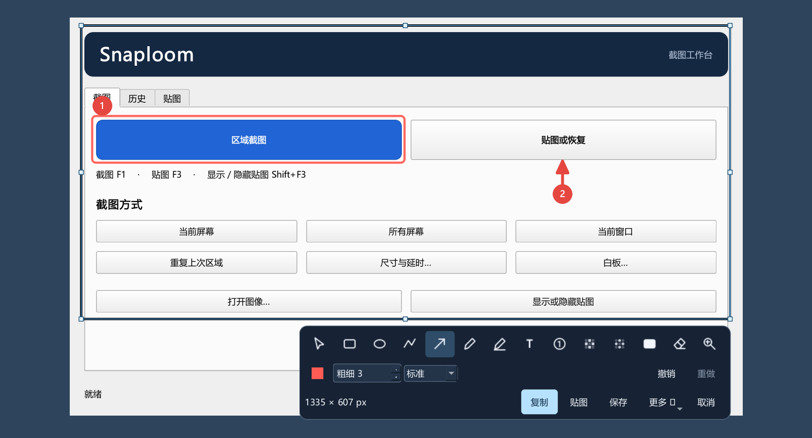

# Snaploom

**框选屏幕上的内容，就地标注，再复制或贴到桌面。**

用 Snaploom 把问题截图发给同事、把示例悬浮在正在操作的窗口旁，或从屏幕上提取可编辑的文字。支持 Windows、macOS 和 Linux，安装包自带运行环境和中英文 OCR 模型。

[下载最新离线版](https://github.com/peterwangze/snaploom/releases/latest) · [选择安装包](#离线安装)



## 用 Snaploom 完成日常工作

### 发一张一眼能看懂的截图

按 **F1** 拖出选区。预览保留原画面亮度，按住 **Alt** 可临时查看放大镜。用箭头指出问题、用编号排好操作顺序，再用实色遮盖挡住敏感内容。拖动边框或按方向键可以微调选区，标注也可以选中、移动或撤销。按 **Enter** 复制结果，直接粘贴到聊天或文档。需要留档时点「保存」。

### 把参考图留在手边

截图后点「贴图」，或复制一张图、一段文字、一个色值，再按 **F3** 把它变成悬浮窗口。对照设计稿、表格或操作步骤时，可以拖动贴图、用滚轮缩放，或按住 **Ctrl／⌘** 滚动调整不透明度。把鼠标移到贴图上，点 **×** 可隐藏这张贴图。按 **Shift + F3** 可一键显示或隐藏贴图。贴图可分组，默认在重启后恢复，移到屏幕外也能从托盘找回。

### 从图片里取文字，把长页面拼成一张

框选内容后点「更多 → 提取文字」，即可在本机识别中英文并复制结果。同一菜单也能识别条形码或二维码。想截下超出一屏的页面时，选「滚动截图」，回到原窗口向下滚动一小段，再点「添加下一帧」。Snaploom 会匹配画面重叠部分，拼好后可以复制、保存或贴图。

## 适合反复使用的细节

- **重复截图省去重新画框。** 按 **Shift + F1** 重用上次选区，适合记录同一个界面的前后变化。也可以预设尺寸和延时，截下悬停菜单。Windows 高分屏上的单屏选区按物理像素导出。
- **快捷键和按钮都能开始。** 托盘和主窗口可直接发起截图或贴图，主窗口还提供当前窗口、当前屏幕、所有屏幕和白板。全局快捷键可改，注册失败会提示。
- **自己决定留下什么。** 自动保存和下载剪贴板网址图片默认关闭。截图历史可调整条数，设为 **0** 即禁用并清理已有记录。贴图单独保存在本机。

## 离线安装

登录有仓库权限的 GitHub 账号后，按系统和处理器选择文件。发布页随包提供 SHA-256 校验文件。

| 系统 | 安装包 | 便携包 |
| --- | --- | --- |
| Windows 10/11 x64 | `*-windows-x64-setup.exe` | `*-windows-x64-portable.zip` |
| macOS 13+ Apple Silicon | `*-macos-arm64.dmg` | DMG 内的应用可拖到所需位置 |
| macOS 13+ Intel | `*-macos-x64.dmg` | DMG 内的应用可拖到所需位置 |
| Linux x64，glibc 2.35+ | `*-linux-x64-setup.run` | `*-linux-x64.tar.gz` |
| Linux ARM64，glibc 2.39+ | `*-linux-arm64-setup.run` | `*-linux-arm64.tar.gz` |

Windows 安装包未签名。macOS 使用临时签名，尚未公证，截图需要屏幕录制权限。Linux 在普通用户的终端执行 `sh Snaploom-版本-linux-架构-setup.run`，需要图形桌面及系统图形库。Wayland 上的截图和全局快捷键取决于系统门户。 [首次启动说明](https://github.com/peterwangze/snaploom/releases/latest) · [平台兼容性与验收记录](docs/release-verification.md)

## 进阶用法

### 命令行自动化

可从脚本截取固定区域、同时保存并复制，或直接把文字贴到桌面。以下命令使用源码入口。安装后可用 Windows 的 `Snaploom-cli.exe`、macOS 应用包内的 `Contents/MacOS/Snaploom` 或 Linux 包内的 `Snaploom`。

```sh
python run_snaploom.py snip --full --block -o ./screen.png
python run_snaploom.py snip --area 20 20 800 600 --hold -o "quick-save;clipboard"
python run_snaploom.py paste --plain "Reference" --pos 160 90
python run_snaploom.py ocr ./screen.png --block
```

<details>
<summary>配置可选的云端 OCR</summary>

在「设置 → 输出」选择云端 OCR 后，主动发起识别会向所选服务发送本次图像。OCR.space 从环境变量 `SNAPLOOM_OCR_SPACE_KEY` 读取凭据。腾讯云读取 `TENCENTCLOUD_SECRET_ID`、`TENCENTCLOUD_SECRET_KEY` 和可选的 `TENCENTCLOUD_REGION`。

</details>

## 开发与验证

```sh
python -m pip install -r requirements.txt
python run_snaploom.py
python run_snaploom.py --smoke-test-ocr
```

交互测试以 `QT_QPA_PLATFORM=offscreen` 运行 `python -m pytest -q`，测试依赖见 `packaging/requirements-build.txt`。原生桌面检查和平台边界见 [交付验收记录](docs/release-verification.md)。 [打包说明](packaging/README.md) · [Snipaste 调研](docs/snipaste-research.md) · [产品设计](docs/product-plan.md)
